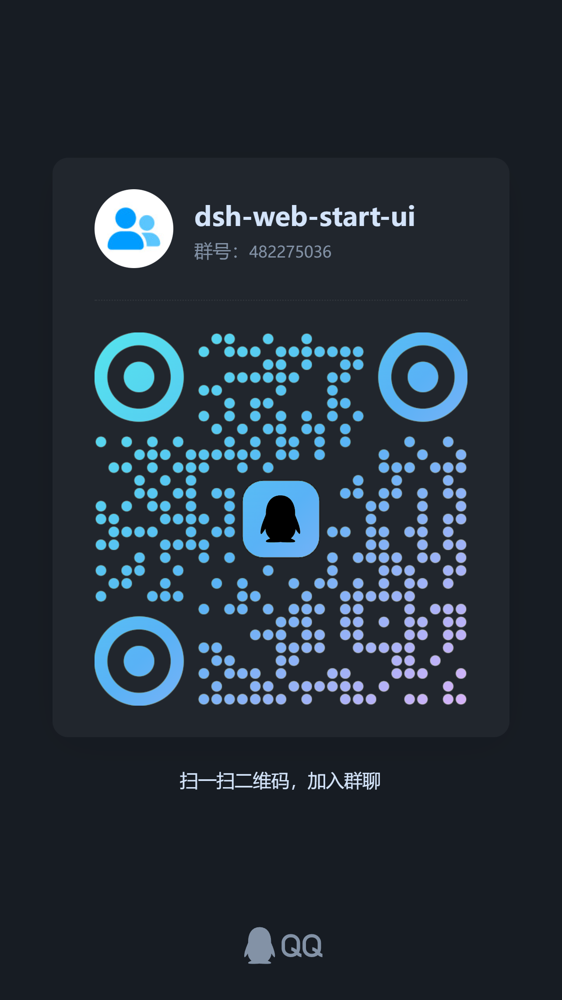

# dsh-web-start-ui · Startup Animation for the DeepSeek Harness (DSH) Web GUI

English | [中文](README.zh.md)

<p align="center">
  
  &nbsp;
  
  &nbsp;
  
</p>

<p align="center">
  <strong>Startup animation for DeepSeek Harness (DSH)</strong><br>
  <em>Launch video skins · On screen before the shell paints · Click or Esc to skip · Its own settings page</em>
</p>

An extension for the DSH Web GUI and desktop client: the page opens on a **launch video** instead of a cold, half-assembled shell, and the curtain lifts when the video ends. It ships two skins, accepts your own uploads, and adds one first-level settings page (Settings → Startup animation). No DSH source change, no third-party request.

## What it does

- **Playing before the GUI paints.** The host half contributes one inline script to the served index.html, so the video element exists and is fetching ~30 ms into navigation. Measured on a 0.2.0-rc.2 host with the shipped skin: element at 3 ms, metadata at 211 ms, playback at 622 ms, while the GUI's own first paint is at 191 ms — the animation is already covering it.
- **Adopted, not restarted.** The browser half takes over that same `<video>` element, so the animation keeps its buffer and its `currentTime` instead of jumping back to the start.
- **Lifts when the video ends** (and not before the shell has painted, bounded by a hold cap). A skin the browser cannot decode lifts on a safety timer instead: a broken video never becomes a wall in front of the GUI.
- **Two sources of skins.** Two are shipped in the package; more can be uploaded from the settings page and deleted there again. See [Launch skins](#launch-skins).
- **Skip on demand.** Click anywhere or press Escape to lift it immediately.
- **Theme aware.** It follows the shell's light/dark preference, remembers it for the next boot's early backdrop, and honours `prefers-reduced-motion`.

## How it works

| Half | What it does |
| --- | --- |
| Host (`src/index.ts`) | Serves the launch-skin catalog and the video bytes (`src/host/routes.ts`: list, select, upload, delete, and Range-capable asset GETs; mutations are loopback-only on top of the platform's own browser auth), and contributes the served index's early backdrop: a global with the selected skin's URLs plus one inline script that paints the backdrop — and starts the video — before the module graph is requested. |
| Browser (`src/client/index.ts`) | Adopts the `<video>` the host started, wraps it in the curtain (the theme backdrop, the skip footnote, the outro), removes the early layer it is covering, and registers the settings section. |

The handoff is deliberately narrow: the early layer is `pointer-events: none`, one z-index step below the real curtain, and it is removed the instant the curtain exists (the adopted video is moved out of it first) — the outro fades to transparent, so a leftover backdrop would otherwise reappear as the GUI came back. A browser half that never loads leaves no dark window behind: the served row arms its own 15 s removal timer.

## Launch skins

A launch skin is a **video**: one directory holding a `skin.json` manifest plus the video (and an optional poster frame). Video is the only medium — there is no style engine — so with no skin selected nothing plays at all. Two sources, one shape:

| Source | Lives in | Gets there by |
| --- | --- | --- |
| Built-in | `assets/launch/<id>/` in this package | `node scripts/add-launch-skin.mjs <video> --name "..."` (`--poster`, `--duration`, `--name-en` optional) |
| Custom | `<DSH_HOME>/launch-animations/<id>/` | the settings page: pick a file, it uploads to the host and becomes selectable |

The selected id is **host state** (`<DSH_HOME>/launch-animations/state.json`), so every browser of one install opens on the same curtain — and the host can start the video *before* the module graph is even requested: the served index carries the skin's URLs plus a small inline script that creates the `<video>`, sets `src` and calls `play()`. The browser half then **adopts that very element** instead of restarting it (measured on a 0.2.0-rc.2 host: element at ~100 ms, GUI first paint at ~230 ms, animated curtain ~600 ms).

**Selection.** A stored choice wins; with nothing stored (a fresh install, or an id whose skin was replaced) the **first built-in skin** plays. Choosing *No skin* stores an explicit null, so the fallback never overrides a choice. The asset route answers with an `ETag`, so a cached install revalidates with a 304 instead of re-downloading megabytes.

**What ships today:** two skins, both with a poster frame.

- `assets/launch/qinghua` — 青花瓷 · 水墨 (Blue-and-White · Ink), 12.28 s, 2024×1080 HEVC, ~16 MB.
- `assets/launch/whale-senren` — 鲸鱼娘 · 千恋万花 (Whale Girl · Senren), 12.25 s, 2560×1440 H.264, ~44 MB.

Together they are most of the package download (see [Install](#install)) and well past the size budget suggested below.

> **Codec note.** `qinghua` is HEVC (H.265), which browsers play through platform hardware decoding. Chrome's `canPlayType('video/mp4; codecs="hvc1"')` reports no support and yet plays it fine when the machine has the decoder (verified: metadata at 211 ms, full playback to 12.28 s). On a machine without HEVC decoding the video errors out, the safety timer lifts the curtain, and no animation appears. To reach every machine, `whale-senren` ships as an H.264 skin — `node scripts/bake-skin-video.py <source> <out-dir> --width 1920 --crf 26 --tune animation` re-encodes a new one to H.264 and pulls a poster frame. The default is still the first built-in in id order (`qinghua`), so on a machine without HEVC decoding pick `whale-senren` from the settings page.

**Suggested spec** for a new skin — it is fetched on first use and played on every boot, so it is the one asset that can make the GUI *slower* to appear:

| | |
| --- | --- |
| Container | H.264 mp4 (custom uploads also accept webm and mov) |
| Picture | 1920×1080, no audio track |
| Length | a few seconds is plenty; the curtain waits for the whole video |
| Size | under 8 MB |
| Last frame | the curtain fades out of it, so end on a calm frame |

Custom skins are deleted from the settings page; built-ins cannot be (they are package files).

## Settings

| Control | Values | Notes |
| --- | --- | --- |
| Enabled | on / off | Off boots straight to the interface — and skips the early backdrop with it. |
| Launch skin | No skin · every built-in skin · every uploaded one | The video that opens DSH; upload and delete custom skins from the same page. |
| Replay | Once per session · Every load | `session` writes a sessionStorage marker. |
| Click to skip | on / off | Escape always lifts the curtain. |
| Preview | button | Plays the selected skin once, right now. |
| Reset | button | Drops the stored playback preferences and returns to the defaults. |

## Install

This plugin is standalone **on purpose**: it is not part of the `@linxin666/dsh-web-all` aggregate, so it never arrives with the family bundle — install it where you want a launch video, and remove it the same way.

### 1. Install the package

The package is **not on npm yet**, so it installs from the repository — which is
exactly what the Workshop's one-click install runs for a registered entry that
carries no `npm` field:

```sh
# web profile
dsh plugin --profile web add https://github.com/stushansusu/dsh-web-start-ui

# desktop client profile
dsh plugin --profile desktop add https://github.com/stushansusu/dsh-web-start-ui

# or from a local checkout, while developing it
dsh plugin --profile web add link:<path to this package>
```

> **Install size: ~61 MB, ~60 MB of it the two shipped skins.** That is well past
> the size budget suggested [above](#launch-skins). Each video is downloaded once
> per install and revalidated with a 304 on every later boot; a given boot fetches
> only the selected skin's video.
>
> **Nothing is built at install time.** `lib/` is committed and shipped as-is,
> so the install needs no compiler, no network toolchain and no build approval —
> which is the contract `scripts/check-package-contract.mjs` and CI pin down.
>
> Working on the plugin? A `src/` change still has to be followed by a rebuild
> of `lib/`, and **that build is not standalone**: `tsdown.config.ts` imports
> `shared/tsdown.client.ts` from the dsh-web monorepo. Rebuild in a checkout of
> that monorepo with this package at `packages/dsh-web-start-ui`, copy `lib/`
> back, then run `node scripts/lib-artifact-check.mjs --write`. CI fails when
> `src/` moves without that fingerprint being refreshed. (`pnpm install` and
> the typecheck/tests run fine here on their own.)

### 2. Restart the host

Quit and reopen the desktop app, or restart `dsh web`. A plugin's host half is loaded at startup — that half serves the skin catalog and starts the video *before* the interface paints, so a reload is not enough.

### 3. Open the settings page

**Settings → 启动动画 / Startup animation.** The default skin (青花瓷 · 水墨 — the first built-in in id order) is selected; press **预览动画 / Preview** to watch it right there, or pick 鲸鱼娘 · 千恋万花, the H.264 one.

### Day to day

| I want to… | Do this |
| --- | --- |
| Use my own video | **添加自定义皮肤** → pick an mp4 / webm / mov (≤ 256 MB); it uploads to the host and is selected |
| Play nothing at all | choose **不用皮肤** |
| Stop it for good | the **启用启动动画** switch, or uninstall the package |
| See it again | **预览动画** |
| Play it only once per window | 播放频率 → **每个会话一次** |
| Skip a long one | click anywhere, or press **Esc** |
| Delete an uploaded skin | **删除** on its tile |

### Where things live

| | |
| --- | --- |
| Shipped skins | `<installation>/node_modules/@linxin666/dsh-web-start-ui/assets/launch/<id>/` |
| Your uploads | `<DSH_HOME>/launch-animations/<id>/` (default `~/.dsh/launch-animations`) |
| The selected skin | `<DSH_HOME>/launch-animations/state.json` |
| Playback preferences | browser storage — see [Preferences](#preferences) |

### Uninstall

```sh
dsh plugin --profile web remove @linxin666/dsh-web-start-ui
```

Delete `<DSH_HOME>/launch-animations` as well if the uploaded videos should go too.

## Preferences

Split in two, on purpose:

- **Playback preferences** live in the browser — `dsh:boot-animation:v1` (localStorage: enabled, replay policy, click to skip), `dsh:boot-animation:theme` (localStorage: the theme the last curtain painted in, which is the early backdrop's only way to know it before the shell exists) and `dsh:boot-animation:played` (sessionStorage: the once-per-session marker).
- **The selected skin and the skins themselves** are host state — `<DSH_HOME>/launch-animations/state.json` and `<DSH_HOME>/launch-animations/<id>/` — so every browser of the install opens on the same curtain, and the host can start the video before the module graph is requested. Nothing here is written to the profile configuration.

## Feedback

<p align="center">
  
</p>

Scan the code to join the group — **bug reports, questions and skin contributions all belong there.** When a curtain misbehaves, please say which skin (the tile name), the browser or client version, and whether the animation appeared at all: those three decide whether it is the host route, the codec or the shell handoff.

## License

Apache-2.0

